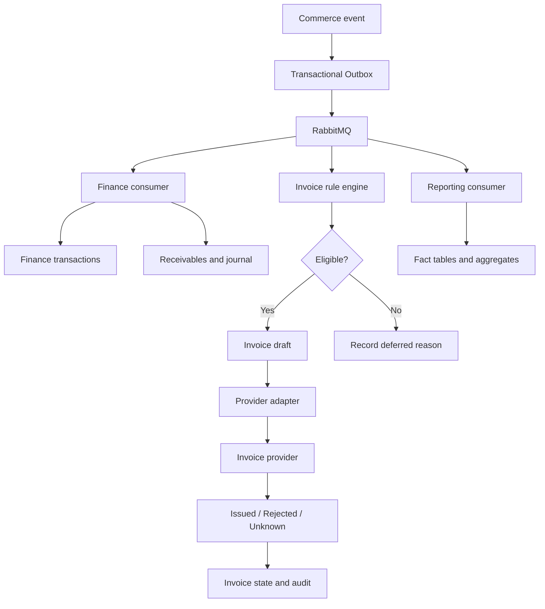

# 02. Architecture and ERD

## 1. Architecture principles

- Modular Monolith first; separate worker processes only when throughput or operational isolation requires it.
- PostgreSQL is transactional source of truth.
- Transactional Outbox publishes events after database commit.
- RabbitMQ carries asynchronous jobs/events.
- Object storage holds original settlement files, invoice XML/PDF and large exports.
- Reporting facts/aggregates are derived and rebuildable.
- Provider adapters isolate vendor-specific APIs.

## 2. Module layout

```text
backend/
  modules/
    legalentity/
    tax/
    finance/
      domain/
      application/
      infrastructure/
      api/
    einvoice/
      domain/
      application/
      provider/{viettel,misa,vnpt,fpt}/
      infrastructure/
      api/
    reconciliation/
      importer/
      normalizer/
      matcher/
      application/
      infrastructure/
      api/
    reporting/
      facts/
      aggregation/
      export/
      api/
    commerce/
    payment/
    inventory/
    audit/
  shared/
    outbox/
    messaging/
    idempotency/
    money/
    storage/
    security/
```

## 3. Event flow



## 4. ERD — core relationships

```mermaid
erDiagram
    LEGAL_ENTITIES ||--o{ TAX_CONFIGURATIONS : has
    LEGAL_ENTITIES ||--o{ ACCOUNTING_PERIODS : has
    LEGAL_ENTITIES ||--o{ INVOICE_PROVIDER_ACCOUNTS : connects
    LEGAL_ENTITIES ||--o{ INVOICES : issues
    LEGAL_ENTITIES ||--o{ JOURNAL_ENTRIES : owns

    FINANCE_TRANSACTIONS ||--o{ FINANCE_TRANSACTION_LINES : contains
    FINANCE_TRANSACTIONS ||--o{ RECEIVABLES : creates
    FINANCE_TRANSACTIONS ||--o{ PAYABLES : creates
    FINANCE_TRANSACTIONS ||--o{ JOURNAL_ENTRIES : posts_from
    JOURNAL_ENTRIES ||--o{ JOURNAL_LINES : contains
    ACCOUNTING_ACCOUNTS ||--o{ JOURNAL_LINES : account

    INVOICE_PROVIDERS ||--o{ INVOICE_PROVIDER_ACCOUNTS : has
    INVOICE_PROVIDERS ||--o{ INVOICES : processes
    INVOICES ||--o{ INVOICE_ITEMS : contains
    INVOICES ||--o{ INVOICE_DOCUMENTS : stores
    INVOICES ||--o{ INVOICE_ISSUANCE_JOBS : queues
    INVOICES ||--o{ INVOICE_AUDIT_LOGS : audits

    RECONCILIATION_SOURCES ||--o{ RECONCILIATION_BATCHES : creates
    RECONCILIATION_BATCHES ||--o{ RECONCILIATION_EXTERNAL_TRANSACTIONS : imports
    RECONCILIATION_BATCHES ||--o{ RECONCILIATION_INTERNAL_TRANSACTIONS : selects
    RECONCILIATION_BATCHES ||--o{ RECONCILIATION_MATCHES : matches
    RECONCILIATION_BATCHES ||--o{ RECONCILIATION_EXCEPTIONS : raises

    RECONCILIATION_EXTERNAL_TRANSACTIONS ||--o{ RECONCILIATION_MATCHES : matched
    RECONCILIATION_INTERNAL_TRANSACTIONS ||--o{ RECONCILIATION_MATCHES : matched
    RECONCILIATION_EXCEPTIONS ||--o{ RECONCILIATION_ADJUSTMENTS : resolved_by
```



## 5. Grain map for reporting

| Fact | Grain | Key dimensions |
|---|---|---|
| `fact_sales` | one order item per event/version or approved daily snapshot | date, order, SKU, channel, store |
| `fact_payments` | one payment/refund transaction | date, order, payment method, channel |
| `fact_settlements` | one external settlement line | date, batch, channel, order |
| `fact_costs` | one cost record/allocation | date, cost type, order, SKU, channel |
| `fact_invoices` | one invoice | issue date, legal entity, channel, status |
| `fact_returns` | one returned order item | date, order, SKU, reason |
| `fact_inventory_movements` | one stock movement | date, SKU, store, movement type |

Use conformed dimensions. Aggregate each fact to a common grain before combining measures from different facts.

## 6. Idempotency strategy

- API writes accept `Idempotency-Key` for externally retried operations.
- Provider issuance uses one persisted key per invoice issuance intent.
- External imported row identity uses source + batch/source transaction ID; where no stable ID exists, use a deterministic fingerprint and flag possible duplicates for review.
- Event consumers store processed event IDs.
- Do not use only `order_id` as an idempotency key for payments/refunds because one order may have multiple transactions.

## 7. Object storage keys

```text
finance/source-files/{source}/{yyyy}/{mm}/{batch-id}/{filename}
einvoice/{legal-entity-id}/{yyyy}/{invoice-id}/original.xml
einvoice/{legal-entity-id}/{yyyy}/{invoice-id}/provider.pdf
reports/{tenant-id}/{job-id}/{filename}
```

Keep object metadata, content hash, byte size and retention class in PostgreSQL.
